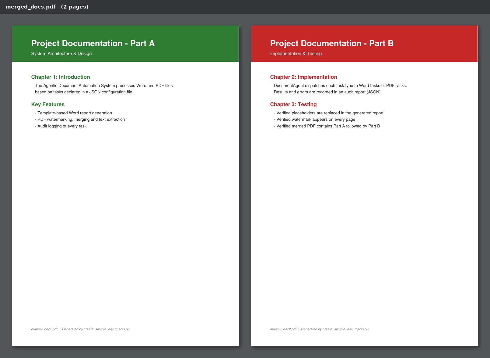
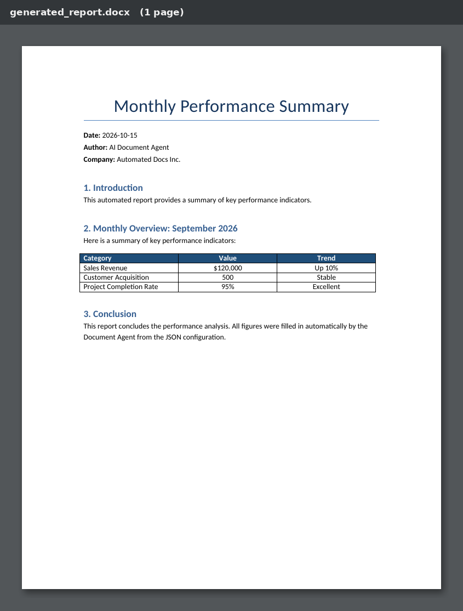
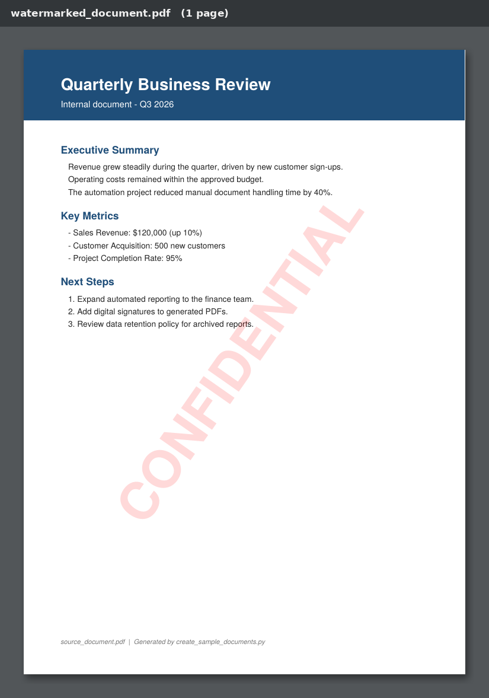

# Week 11 — LabX ADV: Agentic Document Automation (Word & PDF)

**ชื่อ:** สาริษฐ์ บุตรช่วง  **รหัสนักศึกษา:** 663380365-3
**รายวิชา:** SP352301 Script Programming (1/2569)

`DocumentAgent` อ่านรายการ task จาก `configs/document_automation_config.json` แล้วทำงานกับไฟล์ Word และ PDF ตามลำดับ
ได้แก่ สร้างรายงาน Word จากเทมเพลต ใส่ลายน้ำ PDF รวมไฟล์ PDF และดึงข้อความออกจากไฟล์
ทุกขั้นตอนจะถูกบันทึกลง audit report (`documents/reports/audit_report_*.json`)

## ผลลัพธ์ (Screenshots)

### 1. `documents/merged_docs.pdf`
รวม `dummy_doc1.pdf` (Part A) และ `dummy_doc2.pdf` (Part B) เป็นไฟล์เดียว 2 หน้า


### 2. `documents/generated_report.docx`
รายงานที่สร้างจาก `templates/report_template.docx` โดยแทนค่า `{{PLACEHOLDER}}` ทั้งหมด และใส่ตาราง KPI ตรงตำแหน่ง `{{TABLE_PLACEHOLDER}}`


### 3. `documents/watermarked_document.pdf`
`source_document.pdf` ที่ใส่ลายน้ำ **CONFIDENTIAL** (สีแดงโปร่ง 15%, เอียง 55°)


## Tasks ใน config

| # | type | สิ่งที่ทำ | Output |
|---|------|----------|--------|
| 1 | `generate_word_report` | เติม placeholder + ตารางลงเทมเพลต | `generated_report.docx` |
| 2 | `apply_pdf_watermark` | ใส่ลายน้ำ CONFIDENTIAL ทุกหน้า | `watermarked_document.pdf` |
| 3 | `merge_pdfs` | รวม Part A + Part B | `merged_docs.pdf` |
| 4 | `extract_word_text` | ดึงข้อความจากรายงาน Word | `extracted_word_text.txt` |
| 5 | `extract_pdf_text` | ดึงข้อความจาก PDF ต้นฉบับ | `extracted_pdf_text.txt` |

## สิ่งที่ปรับปรุง / แก้บั๊ก

1. **แทนค่า placeholder ไม่ครบ** – config ใช้ key `REPORT_TITLE` แต่เทมเพลตเขียน `{{REPORT_TITLE}}` ทำให้ผลออกมาเป็น `{{Monthly Performance Summary}}` (วงเล็บค้าง) → `word_tasks.py` แปลง key เป็น `{{KEY}}` ให้อัตโนมัติ และรองรับ placeholder ที่ Word แยกเป็นหลาย run
2. **ตารางไปอยู่ท้ายเอกสาร** – เดิม `document.add_table()` ต่อท้ายไฟล์เสมอ → ย้ายตารางไปแทนที่ย่อหน้า `{{TABLE_PLACEHOLDER}}` และจัดหัวตารางให้เป็นตัวหนาพื้นสีน้ำเงิน
3. **`main.py`** – ไม่ได้แปลง `output_path` ของงานสร้าง Word เป็น absolute path (ไฟล์ไปโผล่ตามโฟลเดอร์ที่รันคำสั่ง) และตรวจไฟล์ input โดยอิงลำดับ task (`tasks[0]`, `tasks[1]`) → ตรวจตามชนิด task แทน
4. **`pdf_tasks.py`** – ใช้ `pypdf` (ชื่อใหม่ของ PyPDF2) และ fallback เป็น PyPDF2 ถ้ามีแค่ตัวเก่า
5. เพิ่ม **`create_sample_documents.py`** สร้างเทมเพลต Word และ PDF ตัวอย่างทั้งหมด จึงรันได้ทันทีหลัง clone

## วิธีรัน

```bash
pip install -r requirements.txt
python create_sample_documents.py   # สร้าง templates/ และ PDF ตัวอย่างใน documents/
python main.py                      # รัน Document Agent
```

## โครงสร้างโฟลเดอร์

```
week11/
├── src/
│   ├── __init__.py
│   ├── document_agent.py     # ตัว agent: dispatch task + audit log
│   ├── word_tasks.py         # สร้างรายงานจากเทมเพลต, ดึงข้อความ Word
│   ├── pdf_tasks.py          # ลายน้ำ, รวม PDF, ดึงข้อความ PDF
│   ├── config_parser.py      # โหลดและตรวจสอบ config
│   └── utils.py              # logging, สร้างโฟลเดอร์, audit entry
├── configs/
│   └── document_automation_config.json
├── templates/
│   └── report_template.docx
├── documents/
│   ├── source_document.pdf, dummy_doc1.pdf, dummy_doc2.pdf   # input
│   ├── generated_report.docx                                 # output
│   ├── watermarked_document.pdf                              # output
│   ├── merged_docs.pdf                                       # output
│   ├── extracted_word_text.txt, extracted_pdf_text.txt       # output
│   └── reports/audit_report_*.json
├── screenshots/              # ภาพสำหรับส่งงาน
├── AllCode.md                # รวมโค้ดทั้งหมด
├── create_sample_documents.py
├── main.py
├── requirements.txt
└── README.md
```
